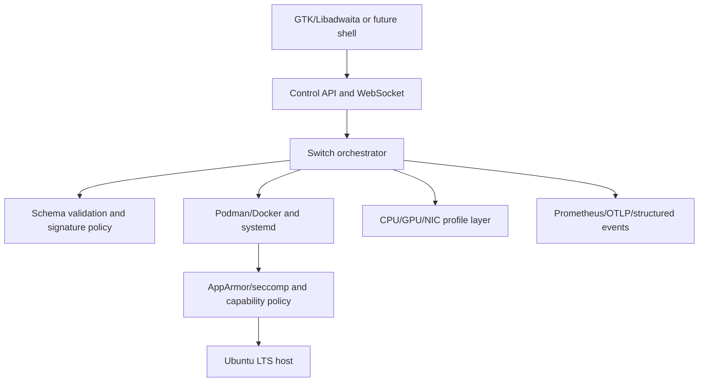

# Gate-OS

**An Ubuntu-based open-source Linux environment manager for one adaptable workstation.**

Gate-OS is building toward one installation that can switch between declarative work environments without rebooting or dual boot. The current repository is a Python manager prototype with API, switching, container/service orchestration, profiles, telemetry, signing, UI logic, packaging helpers, and an ISO build path under active verification.

> **Gate-OS is built by Ultra Cube and belongs to the Ultra Zone community.**
> Ultra Cube is the company behind Ultra Zone, a developer-focused community dedicated to open-source innovation, collaboration, and building impactful software projects. All Ultra Zone releases are open source and freely available for developers to explore, use, modify, and contribute to. Our mission is to empower developers, encourage knowledge sharing, and create an environment where innovative ideas can grow into meaningful projects that benefit the global developer community. Through this initiative, Ultra Cube aims to bring developers together to build large-scale, useful, and sustainable open-source solutions that push the boundaries of technology and make a lasting impact. **Build together. Innovate freely. Open source for everyone.**
> Ultra Zone: https://ultra-zone.ucubetech.com/ · Ultra Cube team: https://github.com/orgs/Ultra-Cube/teams/ultra-zone

## Project status

The latest measured local baseline is **394 passing tests and 94% coverage**, measured with `make test-cov` on 2026-11-01. These are repository measurements, not a compatibility or release guarantee. The ISO builder and QEMU workflow are being developed; no installable ISO release is claimed until a clean build, checksum/signature, BIOS/UEFI boot, and VM installation are evidenced.

Security and supply-chain work remains active. OIDC verification, runtime isolation attachment, manifest-signature enforcement, OTA integrity verification, and cryptographic plugin verification are not yet complete. See [the audit](docs/AUDIT.md) before treating this as production software.

## What it does today

- Loads and validates YAML environment manifests.
- Starts/stops Podman or Docker containers, with a dry-run fallback.
- Manages declared systemd services and CPU performance profiles.
- Switches environments with best-effort rollback and structured telemetry.
- Exposes an optional FastAPI control API, WebSocket status channel, and Prometheus metrics.
- Provides standalone Ed25519 signing tools and packaging/build helpers.
- Includes GTK/Libadwaita UI logic and an optional local/offline MCP development stub.

## Environments

The repository contains example manifests and integration direction. They are not claims that complete application bundles are shipped in an ISO.

| Environment | Direction | Current evidence |
|---|---|---|
| Everyday | Common shell, browser/office, optional Waydroid | Design target; image and installer integration pending |
| Gaming | Proton/Wine, GameMode, controllers, optional proprietary clients | Manifest/examples and design work; hardware evidence pending |
| Development | Editors, terminals, containers, databases | Manager/container primitives available |
| Design | Blender, Krita, GIMP, Inkscape and related tools | Design target; license/package matrix pending |
| Media | Kodi/local libraries and official integrations | Design target; legal integration review required |
| Security | Isolated, consent-based security tools | Profiles exist; runtime enforcement integration pending |
| Business | Browser dashboard and Odoo Community direction | Design target; deployment and license review pending |

Proprietary software, drivers, GApps, DRM, and commercial tools are never redistributed by Gate-OS unless a license review explicitly permits it. See [LICENSES-AND-THIRD-PARTY.md](docs/LICENSES-AND-THIRD-PARTY.md).

## Architecture



See [architecture docs](docs/architecture/overview.md), [the audit](docs/AUDIT.md), and the executable [roadmap](docs/ROADMAP.md).

## Try the manager

Requirements: Python 3.10+ and a virtual environment.

```bash
make setup
make test
make test-cov
make validate
```

For API work, see [Control API](docs/api/control-api.md). Container operations default to safe dry-run behavior when no runtime is available. Do not run privileged image work casually in WSL.

## ISO and installation

The current ISO work targets Ubuntu 24.04 LTS amd64. Use [BUILDING.md](docs/BUILDING.md) for the build boundary and [INSTALL.md](docs/INSTALL.md) for the verification procedure. The local dry-run is not an ISO build and does not prove installation support.

```bash
bash scripts/build-iso.sh --dry-run
```

The CI workflow is intended to build in Ubuntu, verify the upstream checksum manifest, run bounded QEMU BIOS/UEFI smoke tests, and retain logs. Release artifacts remain pending successful CI evidence.

## AI-native direction

Gate-OS is designed to work optionally with Ultra AI through a local-first, reversible contract: native approved UI specs, signed connector manifests, capability tokens, policy checks, sandboxed generated web apps, and audit logs. The model and web content are untrusted data, never instructions. The offline contract stub lives in `ultra_ai_mcp/`; implementation is not a release claim.

## Documentation

- [Phase 0 audit](docs/AUDIT.md)
- [Steel Gate roadmap](docs/ROADMAP.md)
- [Build guide](docs/BUILDING.md)
- [Install verification](docs/INSTALL.md)
- [Security docs](docs/security/overview.md)
- [License and third-party register](docs/LICENSES-AND-THIRD-PARTY.md)
- [AI workspace protocol](docs/ai-workspace/PROTOCOL.md)
- [Changelog](CHANGELOG.md)

## Contributing

Read [CONTRIBUTING.md](CONTRIBUTING.md), use a branch per task, run the existing tests before and after changes, and use conventional commits. New dependencies, network listeners, privileged operations, container images, bundled binaries, and license-sensitive assets require security and license review. No phase is complete from documentation alone; attach reproducible evidence at its checkpoint.

## License

Gate-OS is licensed under [GPL-3.0-or-later](LICENSE). Third-party components retain their own licenses and must be classified in the [third-party register](docs/LICENSES-AND-THIRD-PARTY.md).

Built by Ultra Cube. Developed with the Ultra Zone open-source community.
