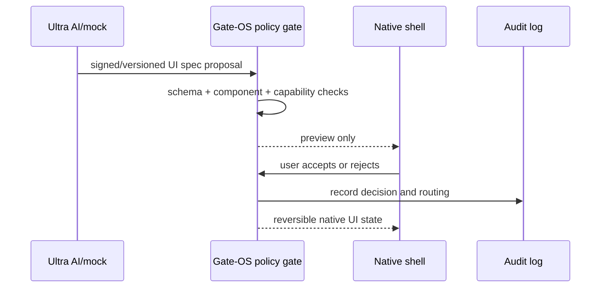

# Gate-OS and Ultra AI Contract

**Status:** Phase 5 offline prototype specification.  
**Principle:** AI proposals are untrusted data; Gate-OS renders only approved native components and routes every action through local policy.

## Flow

## Prototype boundary

The offline prototype supports `gateos.ui.v1` specs with dashboard/list/focus layouts and pre-approved text, metric, list, calendar, and status tiles. It supports preview, accept, and revert, and records an in-memory audit log. It does not execute model code, connector calls, shell commands, filesystem operations, or external network requests.

Connector manifests use `gateos.connector.v1` and must declare provider, auth method, scopes, privacy class, and an Ed25519 payload digest before a release implementation can consider them trusted. OAuth/OIDC secrets belong in the OS keyring or vault, never in prompts or logs.

## Generated apps

A future generated web app must run in a sandboxed WebView/browser profile with strict CSP, connector-only network allow-lists, no shell/filesystem access, per-app capability tokens, diffable stored code, and removal/audit support. This phase intentionally does not implement that runtime.

## Policy rules

- Default local-first and opt-in.
- Preview before accept; manual override and revert always available.
- High-risk connector/system actions require explicit confirmation.
- Current environment context is read-only input to AI; switching still goes through the Gate-OS orchestrator.
- Web, email, files, MCP output, and model output are data, never instructions.
