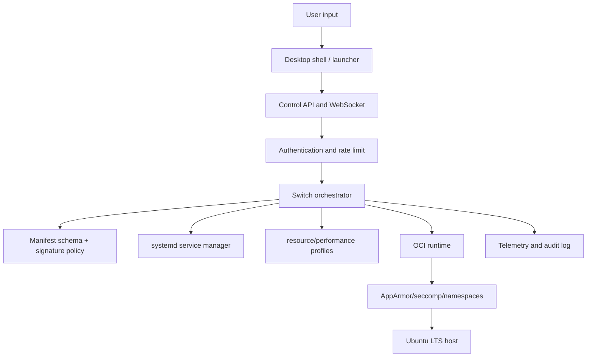
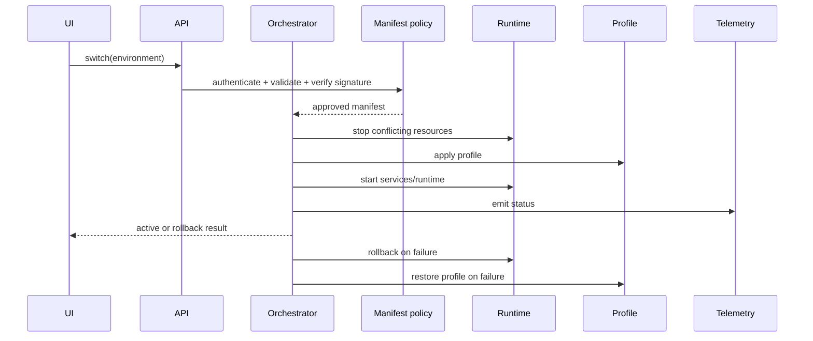

# Gate-OS Integration Specification

**Status:** Phase 3 specification baseline; implementation and security enforcement are tracked separately.  
**Scope:** manager prototype and target installable system.

## Layered model

| Layer | Responsibility | Current interface | Failure mode |
|---|---|---|---|
| Shell/UI | Show environments, request switch, show status/rollback | GTK logic and future shell contract | Keep current shell and expose recovery action |
| API | Authenticate, validate request, rate-limit, broadcast status | FastAPI/WebSocket | Reject unauthenticated or malformed request |
| Orchestrator | Order activation and rollback | `switch_environment()` | Stop started resources and restore profile |
| Manifest | Declare runtime, profile, services, mounts, security | YAML + schema v0.1 draft | Reject invalid/unsigned release manifests |
| Runtime | Start/stop containers and services | Podman/Docker/systemd wrappers | Timeout, inspect state, rollback |
| Isolation | Restrict filesystem, capabilities, syscalls, network | Profiles and future runtime flags | Fail closed for strict/release modes |
| Telemetry | Structured status and audit events | stdout/file/Prometheus/OTLP | Never block switching or leak secrets |
| Host OS | Kernel, Wayland, drivers, filesystem, user session | Ubuntu LTS target | Document unsupported hardware and preserve host recovery |

## Environment specification v2 target

The current schema is `gateos.ultracube.v1alpha1` and remains a draft. The v2 target adds explicit fields that are required for a signed release manifest:

- `metadata.name`, description, tags, owner, and version.
- `spec.upstreams[]`: project, exact version, source URL, digest, SPDX license, and bundled/optional/proprietary classification.
- `spec.runtime`: `oci`, `flatpak`, `native`, `waydroid`, or `web`; image/package digest and entrypoint.
- `spec.resources`: CPU/memory/cgroup limits, GPU request, storage, and network policy.
- `spec.shell` and `spec.launcher`: shared shell or dedicated shell, approved launcher entries, and return-to-desktop action.
- `spec.permissions`: mounts, capabilities, devices, connector scopes, clipboard/file bridge policy.
- `spec.hooks`: signed, bounded, allow-listed lifecycle actions; arbitrary shell hooks are not trusted by default.
- `spec.rollback`: timeout, stop order, profile restoration, and persistent-state policy.
- `security.signature`: signer identity, algorithm, signed payload digest, expiry, and key rotation metadata.

The v2 schema must reject mutable image tags in release mode, unknown capabilities, host mounts outside an approved bridge, and unsigned manifests. Development mode may allow explicit dry-run exceptions that are visible in telemetry.

## Switch pipeline

Timing values are targets, not measurements. A release must publish a method and hardware/VM context for any measured value.

| Stage | Target | Required evidence |
|---|---:|---|
| Auth and validation | <250 ms | API integration test |
| Stop conflicting resources | <2 s | runtime test |
| Profile application | <500 ms | named hardware/VM test |
| Runtime start | environment-specific | container/service logs |
| UI status propagation | <250 ms | WebSocket test |
| Rollback | bounded by configured timeout | forced-failure test |

## Shell strategy

Everyday, Development, Design, and Business target the common desktop shell with environment-specific launcher views. Gaming may add a console-style launcher. Media targets a Kodi-style full-screen mode. Security targets a maintained, reviewed terminal-first shell in an isolated environment. Every mode must expose a global hotkey and persistent action to return to the main desktop; no dedicated shell may trap the user.

The concrete shell technology is not finalized. KDE Plasma/KWin, GNOME/Libadwaita, wlroots/COSMIC, and a custom Qt6/GTK4 shell require proof-of-concepts and an ADR before implementation claims are made. Waybar is only suitable for compatible wlroots-style compositors, not as a universal panel.

## Isolation and data bridge

Always-on resources should be limited to the manager API, authentication, telemetry, environment registry, and desktop shell. Start emulators, Waydroid, Kodi, Odoo, and heavy OCI bundles on demand. Every environment declares CPU/memory/GPU/network limits and a lifecycle timeout.

Cross-environment sharing uses an explicit bridge: approved shared folders, clipboard direction, drag/drop, notifications, and connector scopes. Default is deny. Host paths are never accepted from an untrusted manifest without policy approval. Secrets live in the OS keyring/vault and never in manifests, prompts, telemetry, or generated apps.

## Current implementation boundary

The manager currently has manifest loading, container/service wrappers, profile application, switching, telemetry, API, and standalone signing. The audit identifies missing enforcement for runtime isolation, signature verification during switching, complete OIDC validation, OTA integrity, and cryptographic plugin trust. This document describes the target contract and must not be read as proof that those controls are already active.
