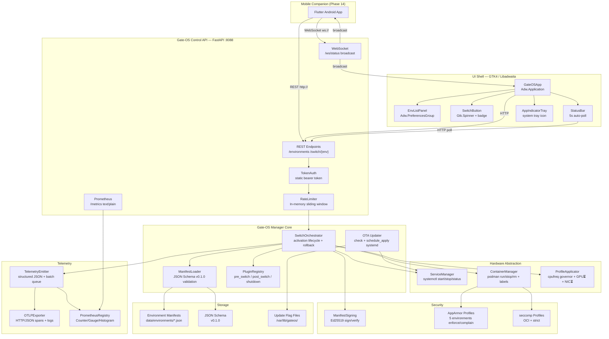

# System Architecture Diagram

> Gate-OS layered component overview — C4 Container level.

## Layer Descriptions

| Layer | Components | Notes |
|-------|-----------|-------|
| Mobile | Flutter app (Phase 14) | WebSocket client + REST switch |
| UI Shell | GTK4/Adwaita panel + tray | Headless-safe (CI mode) |
| Control API | FastAPI :8088 | Token auth, rate limit, Prometheus |
| Manager Core | Orchestrator + Loader + Plugins | Rollback on failure |
| Hardware Abstraction | systemd, podman, cpufreq | Real OS-level control |
| Security | AppArmor/seccomp + Ed25519 | All 5 environments profiled |
| Telemetry | OTLP + Prometheus | No external SDK; stdlib only |
| Storage | JSON manifests + schema | Schema v0.1.0 versioned |

---
**Last updated:** March 2026 | **By:** Fadhel.SH
